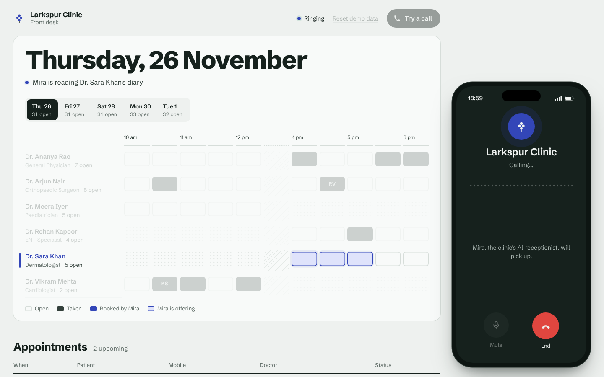

# Larkspur Clinic: voice front desk

A voice AI receptionist that books and cancels doctor appointments, plus a live front-desk dashboard to call it and watch the diary change.



- **Voice pipeline:** [Pipecat](https://github.com/pipecat-ai/pipecat) 1.17 in Python
- **STT:** ElevenLabs Scribe v2 Realtime (streaming)
- **LLM:** Groq running `openai/gpt-oss-120b` (fast, free tier). Gemini also works: set `LLM_PROVIDER` in `.env`
- **TTS:** ElevenLabs Flash v2.5
- **VAD:** Silero, which handles turn detection and barge-in
- **Transport:** Pipecat SmallWebRTC (peer-to-peer WebRTC straight from the browser, so no Daily or Twilio account is needed)
- **Data:** SQLite mock data (6 doctors, 6 working days of 30-minute slots)
- **Frontend:** React + Vite + `@pipecat-ai/client-js`

## Run it

You need Python 3.11+ (3.12 recommended), Node 18+, an ElevenLabs API key and a Groq API key from [console.groq.com](https://console.groq.com).

```bash
# 1. backend
cd backend
python -m venv .venv && source .venv/bin/activate      # Windows: .venv\Scripts\activate
pip install -r requirements.txt
cp .env.example .env                                     # then fill in the keys (see below)
python server.py                                         # http://localhost:7860

# 2. frontend (second terminal)
cd frontend
npm install
npm run dev                                              # http://localhost:5173
```

In `backend/.env`:
```
ELEVENLABS_API_KEY=...
LLM_PROVIDER=groq
GROQ_API_KEY=...
GROQ_MODEL=openai/gpt-oss-120b
```

Open http://localhost:5173, click **Try a call**, allow the microphone, and talk.

For a single server instead, run `npm run build` in `frontend/`. `server.py` then serves the dashboard at http://localhost:7860 too.

Use Chrome or Edge. The first call downloads the Silero VAD model, so it can take a few seconds to pick up.

### Things to say

- "I'd like to see a skin doctor tomorrow evening."
- "Is Dr. Mehta free on Friday?"
- "Book the 4:30 one for Chirag. My number is 98765 43210."
- "Actually, cancel my appointment."

**Reset demo data** in the header restores the original diary before a recording.

## How it works

```
browser mic ──WebRTC──▶ transport.input
                          ▶ ElevenLabs STT (streaming, Silero VAD marks turns)
                          ▶ user context aggregator
                          ▶ LLM (Groq) ─ tool calls ─▶ tools.py ──▶ SQLite
                          ▶ ElevenLabs TTS                └──▶ event bus ──SSE──▶ dashboard
                          ▶ transport.output ──WebRTC──▶ browser speaker
                          ▶ assistant context aggregator
```

| File | What it does |
| --- | --- |
| `backend/bot.py` | Builds the Pipecat pipeline for one call |
| `backend/tools.py` | The four tools the LLM can call, plus the system prompt |
| `backend/store.py` | SQLite schema, seed data, availability, booking and cancellation |
| `backend/server.py` | FastAPI: WebRTC signalling (`/api/offer`), REST for the dashboard, SSE at `/api/events` |
| `backend/test_tools.py` | Runs every tool path without API keys: `python test_tools.py` |
| `frontend/src/useCall.ts` | Pipecat client: connect, transcript, audio tracks, ring and end sounds |
| `frontend/src/Board.tsx` | The day board: doctors × slots, updating live |
| `frontend/src/Phone.tsx` | The in-browser phone call screen |

### Tools

| Tool | Behaviour |
| --- | --- |
| `check_doctor_availability(doctor_name?, speciality?, date?)` | Fuzzy-matches the doctor (STT may hear "Anaya Row"), maps "skin" to Dermatologist and similar, and returns up to 8 open slots |
| `book_appointment(slot_id, phone_number, patient_name, phone_confirmed)` | Refuses unless `phone_confirmed` is true. Normalises `+91 98765-43210` to 10 digits and rejects a slot that's taken or in the past |
| `cancel_appointment(phone_number, phone_confirmed, appointment_id?)` | Finds upcoming bookings by phone. If there are several, it returns them so the agent can ask which one |
| `end_call()` | Hangs up after the goodbye has been spoken |

**Caller identity.** The caller is identified only by the number they say aloud. The prompt makes the agent read it back digit by digit ("9 8 7 6 5, 4 3 2 1 0") and wait for a yes. The `phone_confirmed` argument enforces this in code as well as in the prompt.

### The dashboard

The screen shows what the agent is doing while it does it:

- **Look-ahead.** When Mira checks availability, the board jumps to that day and dims every doctor she isn't looking at. The two or three slots she's about to offer glow, and a caption says what she's doing ("Mira is reading Dr. Sara Khan's diary").
- **Stamp.** When she books, one of those slots stamps solid with the patient's initials, and the new row lights up in the appointments table.
- **Phone.** It has ringing, connected and ended states. The ring is the Indian ringback tone, synthesised with WebAudio. There's a call timer, mute, end call, and a live waveform: blue while Mira speaks, yellow while you do.
- **Transcript.** Each word lights up as it's spoken. If you interrupt, the unspoken part is dropped. Booking and cancellation tickets appear in the timeline.
- **Response time** under every reply, measured from when you stop talking to when she starts. When the call ends, a summary shows its length, the median response time and the outcome.
- On mobile, the phone goes full screen.

## Notes

- Never commit `backend/.env`; it is git-ignored. Only `.env.example` is in the repo.
- To change the voice, set `ELEVENLABS_VOICE_ID` to any voice in your ElevenLabs library. An Indian English voice suits the clinic.
- To use Gemini instead of Groq, remove `LLM_PROVIDER` and set `GOOGLE_API_KEY` (and optionally `GOOGLE_MODEL`, e.g. `gemini-2.5-flash`).
